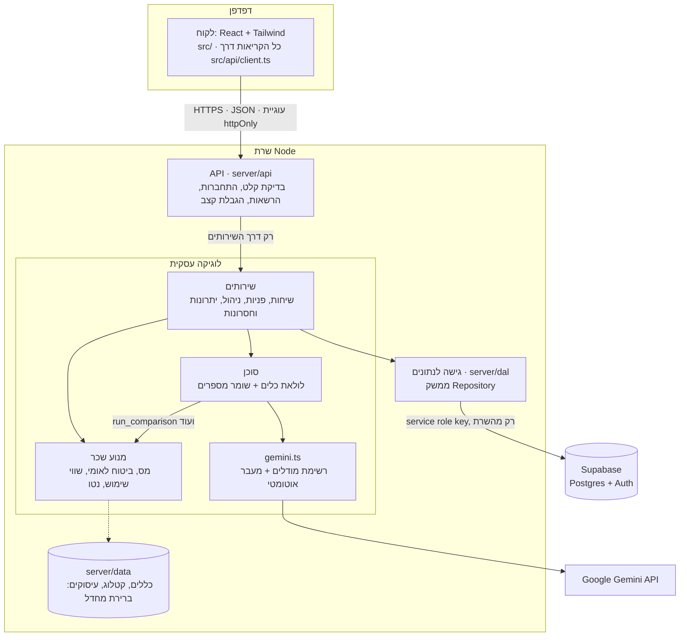
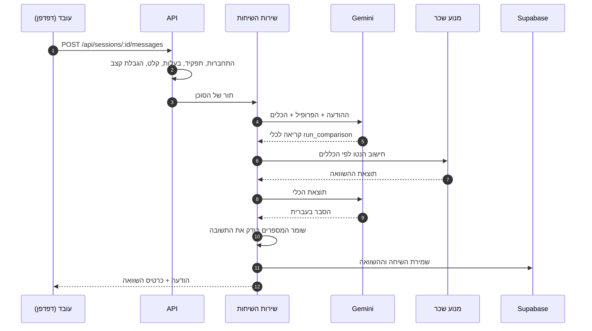

# ארכיטקטורה: יועץ הרכב של שטראוס

צ׳אטבוט בעברית שמשווה את הנטו החודשי בין חלופות רכב חברה. שירות Node.js אחד בשלוש שכבות. הדפדפן מדבר רק עם `/api`, ואין לו גישה לבסיס הנתונים, למודל או לסודות.

## שכבות ורכיבים

| רכיב | תיקייה | תפקיד |
|---|---|---|
| לקוח | [`src/`](../src) | ממשק בעברית עם מסכים לפי תפקיד: עובד (צ׳אט, כרטיס השוואה, פרופיל), נציג שכר, מנהל. בלי סודות, חישובים או סכומים קבועים. |
| API | [`server/api/`](../server/api) | נתיבים `/sessions` `/tickets` `/admin` `/highlights` `/auth`, כולל בדיקת כל קלט, CORS והרשאות. |
| שירותים | [`server/bl/services/`](../server/bl/services) | שיחות, פניות לנציג, ניהול נתונים, יתרונות וחסרונות, התחברות. |
| סוכן | [`server/bl/agent/`](../server/bl/agent) | כלים: `update_profile` `find_car` `list_options` `run_comparison` `escalate_to_rep`. השומר [`guard.ts`](../server/bl/agent/guard.ts) חוסם מספרים שלא הגיעו מהכלים. |
| מנוע שכר | [`server/bl/engine/`](../server/bl/engine) | TypeScript טהור. כל סכום ושיעור נקרא מ-[`strauss-rules.json`](../server/data/strauss-rules.json). |
| גישה לנתונים | [`server/dal/`](../server/dal) | מימוש Supabase בייצור, או קובצי JSON בפיתוח. |
| טיפוסים משותפים | [`shared/types.ts`](../shared/types.ts) | טיפוסים בלבד, ללקוח ולשרת. |

## איפה המודל

Gemini נקרא רק מהשרת, דרך [`server/bl/llm/gemini.ts`](../server/bl/llm/gemini.ts): רשימת מודלים לפי סדר, מעבר אוטומטי למודל הבא כשמודל לא עונה, ומגבלת זמן לכל תור של הסוכן.

- **המודל לא מחשב מספרים.** הוא מבין את העובד, אוסף נתונים, קורא לכלי המנוע ומסביר את התוצאה.
- **שומר מספרים:** כל מספר בתשובה חייב להגיע מהכלים, מהעובד או מהפרופיל. אחרת התשובה נחסמת.
- **שימוש נוסף:** טיוטות של יתרונות וחסרונות לכל רכב, בלי מספרים. מנהל מאשר אותן לפני שהעובדים רואים אותן.

## איפה הנתונים

- **Supabase** (Postgres והתחברות עם אימייל וסיסמה), לפי [`supabase/schema.sql`](../supabase/schema.sql):
  - `sessions`, `messages`: שיחות.
  - `tickets`: פניות לנציג.
  - `app_users`: תפקידים.
  - `app_settings`: כללים, קטלוג ויתרונות וחסרונות שהמנהל מעלה.
  - `tax_records`: שווי שימוש מקובץ רשות המסים.
- RLS פעיל ואין גישה אנונימית. רק השרת ניגש לנתונים, עם service role key.
- **ערכי ברירת מחדל:** [`server/data/`](../server/data). המנהל מחליף אותם בהעלאת קובץ.

## מסלול של שאלה אחת

"כמה נטו ארוויח אם אעבור ל-MG4?": מהצ׳אט ועד כרטיס ההשוואה.

## מה רץ איפה

| איפה | מה |
|---|---|
| דפדפן | ממשק React בלבד |
| שרת Node (Docker, או Vercel: קבצים סטטיים ופונקציה אחת עבור `/api`) | API, לוגיקה עסקית, מנוע, סוכן, גישה לנתונים |
| Google | מודלי Gemini |
| Supabase | נתונים, משתמשים והתחברות |

## איך שומרים על ההפרדה

המבחן [`tests/architecture.test.ts`](../tests/architecture.test.ts) בודק בכל הרצה:

- הלקוח מייבא רק את `src/` ואת `shared/`.
- ה-API מגיע ללוגיקה העסקית רק דרך השירותים, ואף פעם לא לשכבת הנתונים.
- רק [`server/config.ts`](../server/config.ts) קורא משתני סביבה.
- אין בלקוח סכומים או שיעורים שכתובים בקוד.

פרטי פריסה: [DEPLOY.md](DEPLOY.md).
